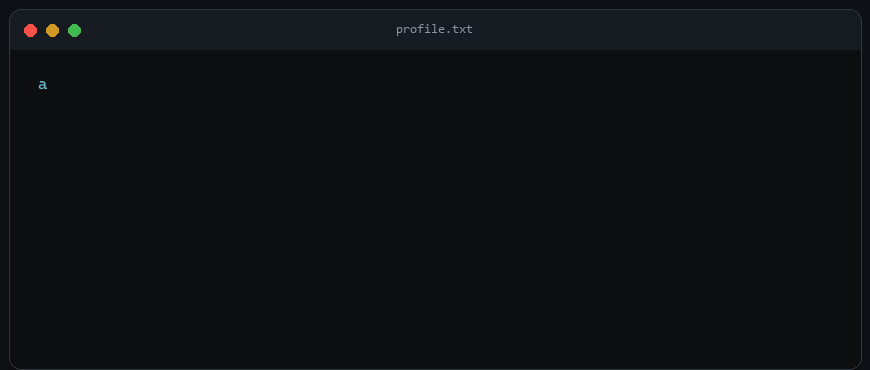

  

  
  
  

## <code>$ whoami</code>

I'm **Alessandro Rizzi**, a Full-Stack Developer focused on user experience. I build web apps, platforms and software that feel clear and natural to use.

To me, code isn't just functionality—it's perception. I focus on the small decisions that make a product feel effortless: structure, spacing, motion, responsiveness, performance and accessibility.

<pre>
01  UNDERSTAND   the problem before choosing the tools
02  STRUCTURE    keep the solution clear and maintainable
03  REFINE       remove friction from the user experience
</pre>

## <code>$ stack --visual</code>

  

## <code>$ ls ~/featured</code>

| Project | What it does | Built with |
|---|---|---|
| **EnVault** | Private owner-only vault for managing application .env files through a web app and CLI. | Next.js · TypeScript · Supabase · Postgres · AES-256-GCM |
| **CodexStatus** | Turns AI coding activity into real-time physical status animations on a custom LED display. | ESP32 · C++ · WS2812 · Node.js · WebSocket · SwiftUI |
| **DoorHub** | Battery-powered e-paper hub for room status, alerts and low-power ambient information. | ESP32-S3 · C++ · E-Paper · WebSocket · SwiftUI |
| **GEOP Calendar Automation** | Extracts university lessons and exams from GEOP, creates ICS files and syncs Google Calendar. | Python · Web scraping · ICS |
| **ParentesiGM.com** | Institutional website with responsive brand storytelling, lead flows and analytics. | React · Node.js · Supabase · Vercel |

## <code>$ git log --projects</code>

| # | Project | Description · technology |
|---|---|---|
| 01 | **Smart Face Security Lock AI** · 2025 | Edge AI smart lock with real-time facial recognition (99.7% accuracy), local user data and embedded access control. C++ · ESP32-CAM · Arduino |
| 02 | **Smart Attendance System** · 2026 | QR and password-based employee attendance, shift handling, work-hour calculations, overtime detection and monthly reports. React · Google Apps Script · Google Sheets |
| 03 | **TCT — Travel Car Trip** · 2026 | iOS trip tracking with continuous GPS, trip history, Live Activities and home-screen widgets. Swift · SwiftUI · CoreLocation |
| 04 | **Line Follower Robot** · 2023 | Autonomous line-following robot with obstacle avoidance and manual joystick control. Arduino · C++ · IR · Ultrasonic |
| 05 | **yt-dlp Desktop Downloader** · 2026 | Desktop downloader with playlist parsing, single-track downloads and a local media library. Python · yt-dlp |
| 06 | **Home Assistant Dashboard** · 2025 | Always-on smart-home dashboard with live device monitoring and OTP authentication. HTML · CSS · JavaScript · REST API |
| 07 | **Personal Portfolio** · 2026 | Responsive AI-inspired portfolio with dynamic project details, interactive UI and backend integrations. Next.js · TypeScript · Supabase · Vercel |
| 08 | **GEOP Calendar Automation** · 2026 | Automates lesson and exam extraction from GEOP, generates ICS files and syncs events to Google Calendar. Python |
| 09 | **NFC Digital Business Card** · 2026 | Mobile-first contact and portfolio sharing by NFC or direct link. Next.js · TypeScript · Vercel |
| 10 | **EnVault** · 2026 | Owner-only secrets vault with web and CLI workflows, encrypted storage and access controls. Next.js · Supabase · Postgres · AES-256-GCM |
| 11 | **ParentesiGM.com** · 2026 | Brand website with responsive storytelling, lead flows and analytics. React · Node.js · Supabase · Vercel |
| 12 | **CodexStatus** · 2026 | A custom ESP32 LED display that translates AI coding activity into live colors and animations. C++ · Node.js · WebSocket · React · SwiftUI |
| 13 | **DoorHub** · 2026 | Low-power e-paper device for remote room states, alerts, audio feedback and battery telemetry. ESP32-S3 · C++ · WebSocket · SwiftUI |

  

## <code>$ contact</code>

If you have an idea to build or improve, [let's talk](https://alessandrorizzi.dev).

  

