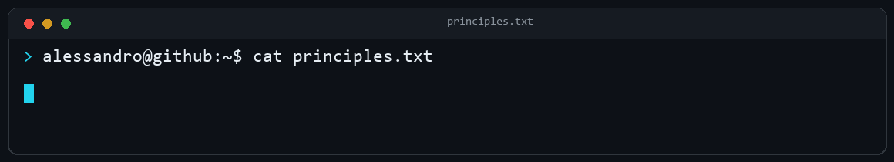

  

  
  
  

## 

I'm **Alessandro Rizzi**, a Full-Stack Developer focused on user experience. I build web apps, platforms and software that feel clear and natural to use.

To me, code isn't just functionality—it's perception. I focus on the small decisions that make a product feel effortless: structure, spacing, motion, responsiveness, performance and accessibility.

  

## 

## 

`$ ls ~/featured`

- **EnVault** — Private owner-only vault for managing application `.env` files through a web app and CLI.  
  `stack:` Next.js · TypeScript · Supabase · Postgres · AES-256-GCM
- **CodexStatus** — Turns AI coding activity into real-time physical status animations on a custom LED display.  
  `stack:` ESP32 · C++ · WS2812 · Node.js · WebSocket · SwiftUI
- **DoorHub** — Battery-powered e-paper hub for room status, alerts and low-power ambient information.  
  `stack:` ESP32-S3 · C++ · E-Paper · WebSocket · SwiftUI
- **GEOP Calendar Automation** — Extracts university lessons and exams from GEOP, creates ICS files and syncs Google Calendar.  
  `stack:` Python · Web scraping · ICS
- **ParentesiGM.com** — Institutional website with responsive brand storytelling, lead flows and analytics.  
  `stack:` React · Node.js · Supabase · Vercel

## 

`$ git log --projects`

- `01` **Smart Face Security Lock AI** · 2025  
  Edge AI smart lock with real-time facial recognition (99.7% accuracy), local user data and embedded access control.  
  `stack:` C++ · ESP32-CAM · Arduino
- `02` **Smart Attendance System** · 2026  
  QR and password-based employee attendance, shift handling, work-hour calculations, overtime detection and monthly reports.  
  `stack:` React · Google Apps Script · Google Sheets
- `03` **TCT — Travel Car Trip** · 2026  
  iOS trip tracking with continuous GPS, trip history, Live Activities and home-screen widgets.  
  `stack:` Swift · SwiftUI · CoreLocation
- `04` **Line Follower Robot** · 2023  
  Autonomous line-following robot with obstacle avoidance and manual joystick control.  
  `stack:` Arduino · C++ · IR · Ultrasonic
- `05` **yt-dlp Desktop Downloader** · 2026  
  Desktop downloader with playlist parsing, single-track downloads and a local media library.  
  `stack:` Python · yt-dlp
- `06` **Home Assistant Dashboard** · 2025  
  Always-on smart-home dashboard with live device monitoring and OTP authentication.  
  `stack:` HTML · CSS · JavaScript · REST API
- `07` **Personal Portfolio** · 2026  
  Responsive AI-inspired portfolio with dynamic project details, interactive UI and backend integrations.  
  `stack:` Next.js · TypeScript · Supabase · Vercel
- `08` **GEOP Calendar Automation** · 2026  
  Automates lesson and exam extraction from GEOP, generates ICS files and syncs events to Google Calendar.  
  `stack:` Python
- `09` **NFC Digital Business Card** · 2026  
  Mobile-first contact and portfolio sharing by NFC or direct link.  
  `stack:` Next.js · TypeScript · Vercel
- `10` **EnVault** · 2026  
  Owner-only secrets vault with web and CLI workflows, encrypted storage and access controls.  
  `stack:` Next.js · Supabase · Postgres · AES-256-GCM
- `11` **ParentesiGM.com** · 2026  
  Brand website with responsive storytelling, lead flows and analytics.  
  `stack:` React · Node.js · Supabase · Vercel
- `12` **CodexStatus** · 2026  
  A custom ESP32 LED display that translates AI coding activity into live colors and animations.  
  `stack:` C++ · Node.js · WebSocket · React · SwiftUI
- `13` **DoorHub** · 2026  
  Low-power e-paper device for remote room states, alerts, audio feedback and battery telemetry.  
  `stack:` ESP32-S3 · C++ · WebSocket · SwiftUI

  

## 

If you have an idea to build or improve, [let's talk](https://alessandrorizzi.dev).

  

